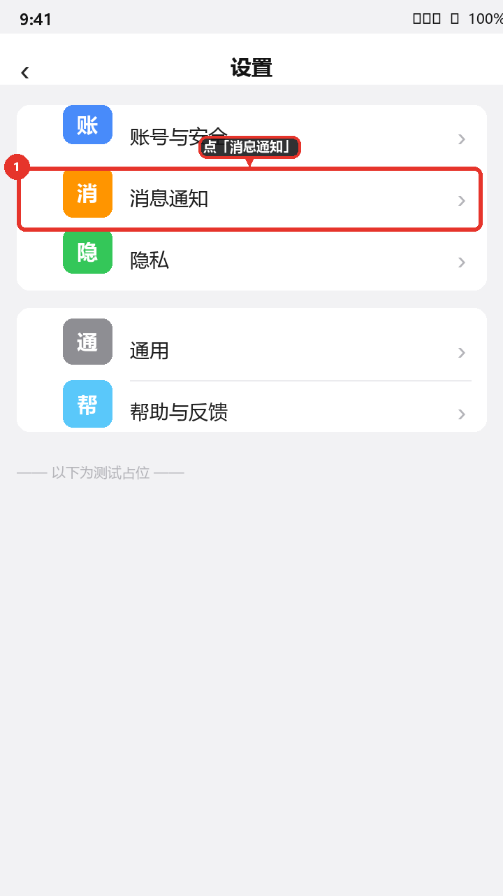

# App Navigator · APP 操作向导


> 用户上传一张 APP 截图 + 说明想完成的任务，AI 看着当前这一屏推理出下一步该点哪里，在原图上画红框/箭头/序号返回；用户照着点完再回传新截图，一步步直到任务解决。

一个 [WorkBuddy](https://www.workbuddy.cn/) Skill。它不写教程文章，而是**陪一个人把手头的任务做完**。

## 效果预览

用户传图 → AI 圈出下一步 → 用户照着点 → 回传新图，如此循环：



*红框圈住目标按钮，配序号与中文标签——用户不用读文字描述，照着点即可。*

## 它解决什么

"帮我看看这个功能在哪"——传统做法是给一段文字教程，但 APP 界面因版本、机型、账号状态而异，文字教程经常对不上。这个 Skill 换了个思路：**只看用户当前这一屏，给一个确定的动作，然后等用户走完再继续。**

## 六条设计决策

这个 Skill 的设计经过逐条拷问，六个分支全部钉死：

| 分支 | 决策 | 理由 |
|------|------|------|
| 产品定位 | 任务驱动为主，导览降级为兜底 | 任务有明确成功标准，"快速了解一个 APP"容易做成鸡肋 |
| 交付形态 | WorkBuddy Skill，对话式向导 | 验证核心假设最快，不用碰读屏权限 |
| 知识来源 | 纯现场视觉推理 | 通用任何 APP；知识库路线会被内容生产拖死 |
| 闭环反馈 | 每步回传截图 | 视觉推理不能中途把眼睛蒙上 |
| 输出形式 | 原图画红框/箭头/序号 | 用户照着点，零理解成本 |
| 可靠性兜底 | 认怂 + 可纠错 | 会认怂的向导比自信胡指的有用一百倍 |

## 三条硬规矩

1. **一次只给一个动作**——提前列的步骤大概率对不上变化后的界面。
2. **只看当前截图推理**——图上没有的按钮一律不算。
3. **认怂优先于胡指**——看不清就请用户补图，用户报错就作废重来。

## 安装

把整个 `app-navigator/` 目录放到 WorkBuddy 的 skills 目录：

```
C:\Users\<你>\.workbuddy\skills\app-navigator\   # Windows
~/.workbuddy/skills/app-navigator/                # macOS / Linux
```

重启 WorkBuddy 后，用 `@skill:app-navigator` 调用，或直接上传截图说清任务。

## 文件结构

```
app-navigator/
├── SKILL.md                 # 工作流大脑：硬规矩 + Step 0~4 + 反模式
├── README.md                # 本说明
├── LICENSE                  # MIT 开源协议
├── assets/
│   └── demo.png             # 演示标注效果图
└── scripts/
    └── annotate.py          # 标注引擎：归一化坐标 → 红框/序号/中文标签/箭头
```

## 依赖

- Python 3.x
- Pillow（`pip install Pillow`）

标注坐标采用 `0–1000` 归一化体系，与图片像素尺寸无关，脚本自动适配中文字体并避让标签位置。

```bash
python annotate.py --image <原图> --output <输出图> --marks '<JSON数组>'
# 或
python annotate.py --image <原图> --output <输出图> --marks-file <marks.json>
```

## 一次真实实测

拿某校园 APP 查"第二课堂学分"：广场 → 我的（认怂）→ 校园 → 学工系统 → 服务大厅 → 找到。四步走完，中途认怂两次、改向一次，没硬编不存在的按钮。完整闭环跑通。

## 已知限制

- 只做"阅读屏幕 + 指出操作"，不代替点击，不碰用户账号数据。
- 遇到密码、验证码等隐私输入，会提醒用户自己输入。
- 准确率瓶颈在视觉模型对 UI 元素的识别；低置信度认怂机制是重要的安全网。

## License

本项目采用 [MIT License](LICENSE)，可自由使用、修改、分发，包括商用。唯一要求是保留版权声明。
